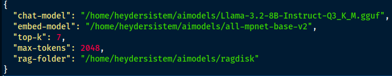
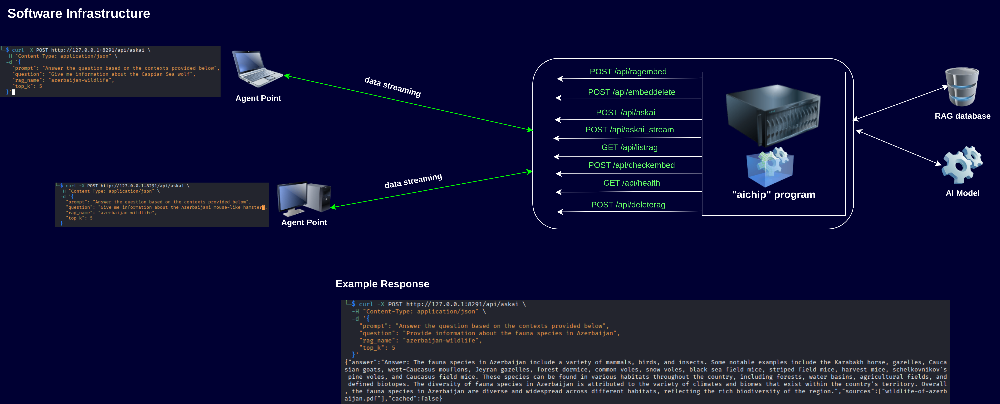
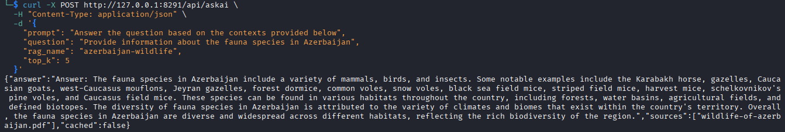

# 'aichip' project

Would you like your data analysis tool, developed using any programming language, to use a native AI to compile the data you provide via API and present you with processed data in natural language? Normally, to do this locally, your data would need to be embedded in a RAG database and processed by a model to provide you with results, but this process would require writing and managing code within the code itself. On the other hand, you can't do this in every language. Let's say your agent software is JavaScript. Then you would need to set up a separate, simple API system so that your JavaScript code can pass data to the model using the RAG+model structure. If you have multiple agent codes created for different purposes, you will have to integrate RAG+model into all of them, causing model loading for each agent, straining your computer, lacking consistency, and limiting your usability.


'aichip' is a local API-supported software that allows you to run a downloaded local model with data you train yourself. After defining a model, you can run it, send any document via the API, train it with a specified RAG database name, ask questions, or provide data to make inferences. You only write code for processes like data collection and categorization; you send the compilation and inference processes to 'aichip'. You can then process the resulting code for a specific purpose. The purpose and scope of the agent architecture are limited only by your imagination.

---

## Run server

The application runs locally on:

- **Address:** `127.0.0.1`
- **Port:** `8291`

---

## Installation
First, you need to download the embed model and the speech model. Download these two models from HuggingFace for testing purposes:

[Llama-3.2-8B-Instruct-GGUF](https://huggingface.co/tensorblock/Llama-3.2-8B-Instruct-GGUF)

[all-mpnet-base-v2](https://huggingface.co/sentence-transformers/all-mpnet-base-v2)

You will specify where you downloaded these from in the configuration file.

```
git clone https://github.com/heyderismayilli092/aichip
cd aichip
python3 -m venv ai_environment
source ai_environment/bin/activate
pip install -r requirements.txt
```

Fill in the configuration file. Example:


Service run:
`uvicorn aichip:app --reload --host 127.0.0.1 --port 8291`

---

## System Architecture


The software's APIs are the ways to trigger and use the software appropriately. Using the appropriate APIs, you can create a new RAG database, send as many PDF, TXT, or DOCX files to the database as you want, and send any query using different RAG databases that have been created. The outputs are returned in JSON format.

## Available APIs
| API | Feature |
|---|---|
| POST /api/ragembed | It allows you to create a RAG database using any file. You can also embed another file into the same RAG database using this API |
| POST /api/embeddelete | When the same file is sent again, it cleans the embedded data of that file from the RAG database |
| POST /api/askai_stream | The desired operation is performed by providing the system prompt, prompt number, resource count, and RAG database values; however, when a response is generated, these responses are printed (you can use this feature to print real-time series in a web interface) |
| GET /api/listrag | The existing RAG database is listed |
| POST /api/checkembed | The hash value of a file is sent to verify that the file has been written to the RAG database |
| GET /api/health | The software is verified to be working without any problems |
| POST /api/deleterag | The entire RAG database that was created will be deleted |

## Use Example
The software is currently running. At this stage, we will create a RAG database and, along with the downloaded model, provide it with prompts and output. We will perform these operations using the `curl` command, but you can also call these APIs using Python or Javascript if you prefer.

We need a source PDF file. We will use this file to embed it into the RAG database. Let's do this by running the following command:
```
curl -X POST http://127.0.0.1:8291/api/ragembed \
  -F "file=@Desktop/wildlife-of-azerbaijan.pdf" \
  -F "index_name=azerbaijan-wildlife"
```
Output:
`{"status":"successfully"}`

Now let's ask a question using the model:
```
curl -X POST http://127.0.0.1:8291/api/askai \                                      
  -H "Content-Type: application/json" \
  -d '{
    "prompt": "Answer the question based on the contexts provided below",
    "question": "Provide information about the fauna species in Azerbaijan",
    "rag_name": "azerbaijan-wildlife",
    "top_k": 5
  }'
```

The output will be returned in JSON format as the answer and the resources used:


